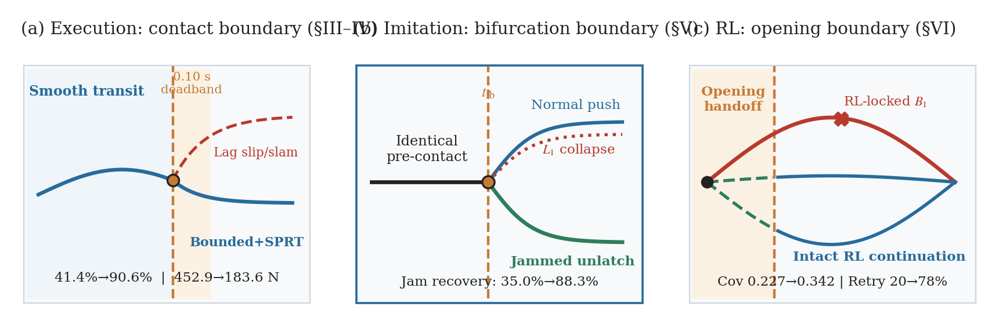

<div align="center">

# Boundary Fragility in Chunked Robot Manipulation<br>and Post-Training

**Qiancheng Zhou**

School of Future Technology, Shanghai University

[`zhou_3721@shu.edu.cn`](mailto:zhou_3721@shu.edu.cn)

[](https://github.com/ershiyidian/libero-selftest)
[](https://huggingface.co/datasets/esyd/libero-selftest)
[](LICENSE)
[](https://www.python.org/)

<picture>
  <source media="(prefers-color-scheme: dark)" srcset="assets/overview-dark.png">
  
</picture>

<p align="center"><sub><strong>Figure 1: Boundary fragility across a chunked manipulation trajectory and post-training lifecycle.</strong> (a) Physical contact boundaries during delayed approach and initial finger-pad compliance; (b) post-contact bifurcation boundaries in chunked imitation learning; (c) opening branch boundaries in outcome-based RL post-training.</sub></p>

</div>

## Overview

Foundation models for robot manipulation bridge slow inference and fast control by executing multi-step **action chunks** open-loop per query, yet frequently fail during fine contact, unseen mechanical resistance, and post-failure retries. Existing remedies assume open-loop errors accumulate uniformly over time, globally shortening horizons or averaging overlapping predictions.

We show that smooth motion interiors are locally contractive; failures concentrate sharply across **physical contact boundaries** and **decision branching boundaries** encountered chronologically along deployment:

- **Physical Contact Boundaries (Execution):** Periodic sawtooth lag crosses stability limits near docking and pushes curved-rim grasps outside Coulomb self-locking disks, while initial elastic finger-pad compression creates a $0.10\,\mathrm{s}$ zero-information deadband before low- and high-resistance joint displacements separate and rigid closure risks backstop slam.
- **Post-Contact Bifurcation Boundaries (Imitation):** Once contact exposes free versus jammed motion, supervising an unmasked $L_1$ action chunk across the feedback instant $t_{\mathrm{fb}}$ collapses predictions onto the majority push branch, while unconditional asynchronous prefix skipping discards unlatch prefixes under physical stall.
- **Opening Branch Boundaries (RL Post-Training):** Outcome-based reinforcement post-training (RIPT-VLA / GRPO / PPO) narrows multi-attempt retry diversity strictly at the **opening branch boundary** while leaving downstream execution within suppressed corridors intact—enabling zero-retraining opening handoff to recover multi-route retries at full single-try accuracy.

### Empirical Highlights

- **Asynchronous Approach & Curved Contact (`500 Hz` MuJoCo):** Periodic Floquet gain bounding pulls delayed VLA grasps back inside the $52.3\,\mathrm{mm}$ self-locking disk ($70.4\,\mathrm{mm} \to 51.8\,\mathrm{mm}$), lifting asynchronous task completion from **41.4%** to **90.6%**.
- **Post-Deadband Sequential Probing (`800` Articulated Rollouts):** Online Wald SPRT after the $2$-step compliance deadband paired with closure target withdrawal resolves unseen joint resistance in **3.39 steps** at **86.9%** accuracy while cutting peak backstop force from **452.9 N** to **183.6 N** (and cutting SmolVLA-450M safety overloads by **6.5x**, from **32.5%** to **5.0%**).
- **Causal Boundary Truncation on `LIBERO-SelfTest` (`130` Tasks, `1,040` Episodes):** Pairing causal truncation at $t_{\mathrm{fb}}$ with conditional flow matching and stall-triggered replanning raises jammed recovery from **35.0%** to **88.3%** (and restores latched SmolVLA-450M recovery from **0.0%** to **47.2%**), while leaving single-physics tasks without mid-chunk branching unchanged.
- **Zero-Retraining Opening Handoff (`7B` OpenVLA-OFT & Closed-Loop Retry):** Running the pre-RL policy solely across the opening approach steps restores 7B VLA 3D corridor coverage (`Phys-Cov@8`) from **0.227** to **0.342** at full RL accuracy (**0.675**), and lifts `200 ms` closed-loop jammed-subgoal retry completion from **20.0%** to **78.0%**.

| Lifecycle Stage | Boundary Mechanism | Failure Under Uniform Chunking | Targeted Boundary Intervention | Key Gain |
| :--- | :--- | :--- | :--- | :--- |
| **Approach** | Sawtooth lag & curved rim ($r_{\mathrm{crit}}$) | Jaw slip outside friction cone (`41.4%`) | Periodic Floquet bound ($\bar{\rho} < 1$) | **90.6%** async grasp |
| **Initial Touch** | Finger-pad deadband & joint stop | Zero-info probe / `452.9 N` slam | Post-deadband Wald SPRT + withdrawal | **183.6 N** peak (`5.0%` ovld) |
| **Continuation** | Post-contact bifurcation ($t_{\mathrm{fb}}$) | Majority-branch $L_1$ collapse (`3.3%`) | Causal mask + flow matching + stall gate | **88.3%** jam recovery |
| **Post-Training** | Opening branch commitment ($B_1$) | Repeated blocked retries (`20.0%`) | Pre-RL opening handoff (`SFT -> RL`) | **78.0%** `200 ms` retry |

## LIBERO-SelfTest Dataset

The replay-verified [**LIBERO-SelfTest**](https://huggingface.co/datasets/esyd/libero-selftest) benchmark spans all **130 tasks** across the five LIBERO suites in `500 Hz` MuJoCo physics, pairing nominal pass demonstrations with contact-perturbation and recovery trajectories annotated with role masks (`setup` / `pass` / `recovery`) and changepoint-verified physical feedback instants $t_{\mathrm{fb}}$.

| Suite | Tasks | Episodes | Executed Steps | Retained Demo Steps | Probe & Feedback Boundaries | Cross-Boundary Windows |
| :--- | :---: | :---: | :---: | :---: | :---: | :---: |
| `libero_spatial` | 10 | 80 | 23,558 | 22,358 | 221 | 6.84% |
| `libero_object` | 10 | 80 | 25,297 | 24,097 | 216 | 6.12% |
| `libero_goal` | 10 | 80 | 24,912 | 23,712 | 234 | 7.45% |
| `libero_10` | 10 | 80 | 34,864 | 33,664 | 249 | 5.13% |
| `libero_90` | 90 | 720 | 233,428 | 223,141 | 1,928 | 8.06% |
| **Total** | **130** | **1,040** | **342,059** | **326,972** | **2,848** | **5.13% – 8.06%** |

Download directly from Hugging Face:

```python
from huggingface_hub import snapshot_download

dataset_dir = snapshot_download(
    repo_id="esyd/libero-selftest",
    repo_type="dataset",
    local_dir="./data/libero-selftest",
)
```

## Repository Structure

```text
libero-selftest/
├── assets/                          # Light/dark adaptive overview figures
├── core/                            # Causal chunk masking, physics replay & trajectory memory
├── scripts/
│   ├── dataset/                     # Replay-verified LIBERO-SelfTest collection, changepoints & HF export
│   ├── physics_boundaries/          # Sawtooth Floquet delay, curved-rim basin & post-deadband Wald SPRT
│   ├── imitation_bifurcation/       # L1 vs. Flow-ChunkNet, TaskFiLM-ResNet18 & SmolVLA-450M stall gating
│   └── rl_posttraining/             # 7B OpenVLA-OFT RIPT audit, Countdown exact trees & MuJoCo jammed retry
├── configs/                         # Suite splits and controller hyperparameters
└── figures/                         # Publication figure reproduction scripts
```

## Installation & Quick Start

```bash
git clone https://github.com/ershiyidian/libero-selftest.git
cd libero-selftest
pip install -r requirements.txt
```

```bash
# 1. Build & replay-verify LIBERO-SelfTest episodes and boundary changepoints
python scripts/dataset/collect_selftest_episodes.py --suite libero_spatial --episodes-per-task 8
python scripts/dataset/annotate_feedback_boundaries.py --data-root ./data/libero-selftest

# 2. Run approach-delay Floquet stability & post-deadband Wald SPRT probing audits
python scripts/physics_boundaries/eval_sawtooth_delay_vla.py --delays-ms 0 100 200 300
python scripts/physics_boundaries/eval_wald_sprt_probing.py --num-rollouts 800

# 3. Train & evaluate causal boundary-masked chunk policies and SmolVLA stall gating
python scripts/imitation_bifurcation/train_eval_bifurcation_chunks.py --mask causal_trunc
python scripts/imitation_bifurcation/eval_smolvla_stall_gating.py --disp-gate-mm 4.5

# 4. Run 7B OpenVLA-OFT opening handoff & 500 Hz MuJoCo jammed-subgoal retry
python scripts/rl_posttraining/eval_openvla_opening_handoff.py --handoff-steps 40
python scripts/rl_posttraining/eval_mujoco_jammed_retry.py --delay-ms 200 --attempts 3
```

## License and Citation

This project is released under the [MIT License](LICENSE). If you find our code, analysis, or the `LIBERO-SelfTest` dataset useful, please consider citing:

```bibtex
@article{zhou2026boundary,
  title   = {Boundary Fragility in Chunked Robot Manipulation and Post-Training},
  author  = {Zhou, Qiancheng},
  journal = {arXiv preprint},
  year    = {2026}
}
```
